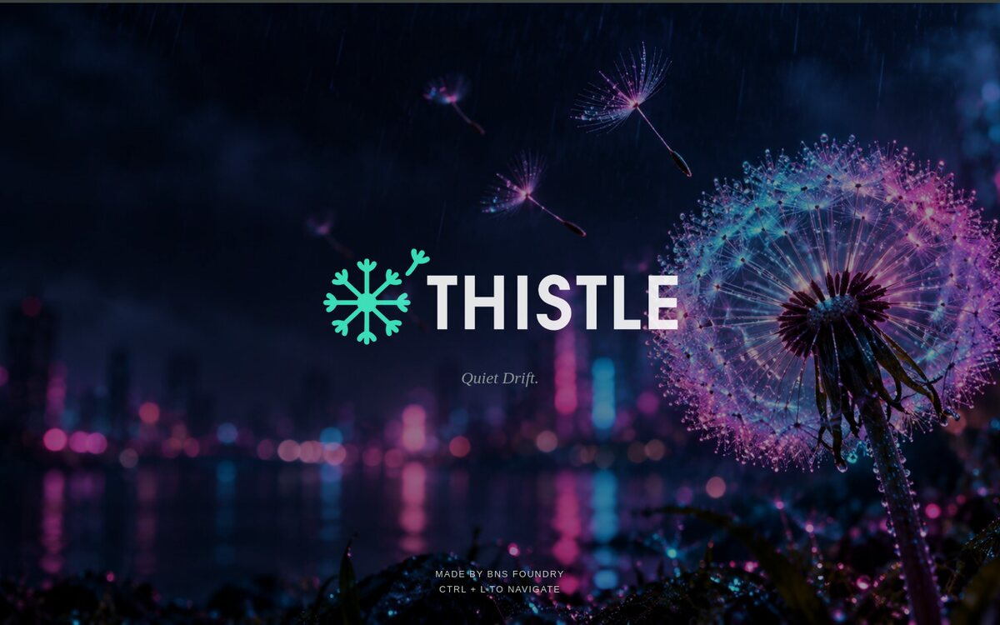
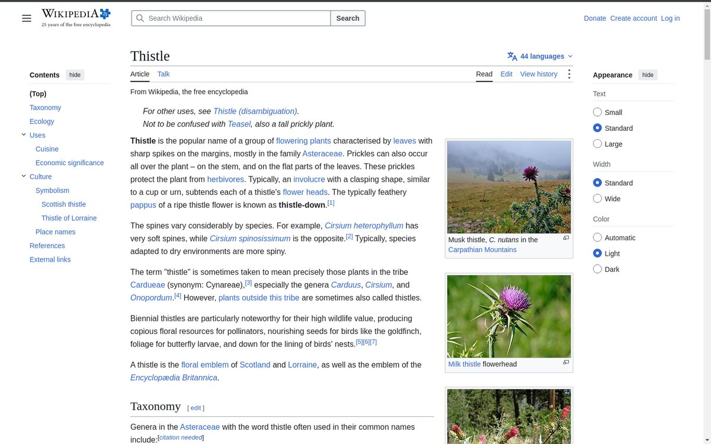
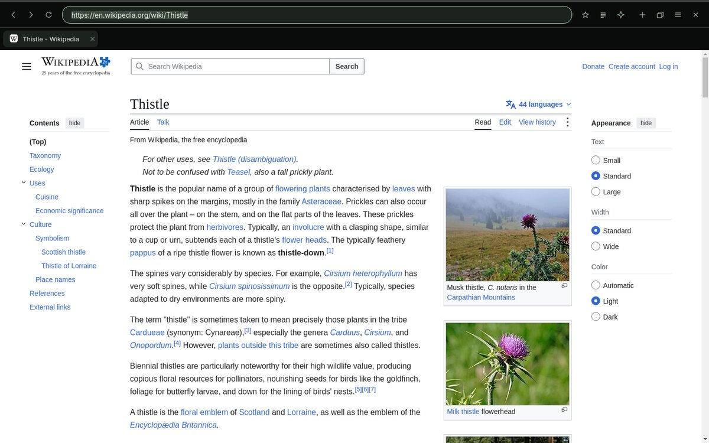

# THISTLE

A quiet, keyboard-first web browser for Linux. The page fills the window; the address bar and tabs stay out of the way until you ask for them. Built on Qt WebEngine (Chromium) with Python and PySide6. Made by BNS Foundry, and the browser of Danderlion OS.



| Reading, controls hidden | Ctrl+L shows the address bar and tabs |
|---|---|
|  |  |

## Install

You need Linux with a desktop, and Python 3 with `venv` (on Ubuntu and Debian: `sudo apt install python3-venv`).

```bash
git clone https://github.com/bnsceo/thistle.git
cd thistle
bash start.sh
```

The first launch downloads the browser engine (PySide6, a few hundred MB) into a `.venv` folder next to the app. Later launches start straight away. Nothing is installed system-wide, and your other browsers' profiles are never touched. Run it as your normal user, never with sudo.

To open links from the command line: `bash start.sh https://example.com` or `bash start.sh --private`.

If the first launch reports a missing library (a file ending in `.so`), install it with your package manager. On Ubuntu and Debian the usual ones are `libxcb-cursor0`, `libatomic1` and `libasound2t64`; on Fedora, `xcb-util-cursor` and `libatomic`.

## Use

- **Ctrl+L**: show the address bar. Type an address or a search and press Enter.
- **Escape** (in the address bar): hide the controls again. Pages keep their own Escape.
- **Ctrl+T / Ctrl+W / Ctrl+Shift+T**: new tab, close tab, reopen the last closed tab.
- **Ctrl+K**: find a tab by typing. **Ctrl+Tab / Ctrl+Shift+Tab**: next or previous tab.
- **Ctrl+Shift+P**: every command, including bookmarks, history, Clear history, Delete cookies, settings and backgrounds.
- **Ctrl+D**: bookmark this page. **Ctrl+H**: history.
- **Ctrl+Shift+N**: private window.
- **Alt+Z**: Zen reading mode. **Alt+B**: next new-tab background.
- **Ctrl+Shift+S**: scratchpad.
- **Ctrl+Shift+A**: Laya, an optional assistant that talks to a local [Ollama](https://ollama.com) server. The browser works fine without it.

Settings (in the Ctrl+Shift+P menu) cover five colour themes, the search engine, keeping the controls always visible, restoring your tabs, and the new-tab background.

## Privacy

- No telemetry, accounts or sync. Searches go out only when you submit them; DuckDuckGo is the default.
- Your settings, bookmarks, history, open tabs and browsing profile stay in `~/.config/Thistle`. Clear history (Ctrl+Shift+P) wipes the saved history, recently closed tabs and each tab's back and forward.
- Private windows keep nothing after they close, except files you choose to download.
- Sites must ask before using your camera, microphone, location or notifications, and the answer defaults to no. Invalid certificates are refused.
- Requests to a short built-in list of ad and tracking domains are blocked. It is not a full tracker blocker or an anonymity tool.
- Laya sends your question and the current page's title and address to the Ollama server you set (by default `localhost`, which never leaves your computer). The panel warns you when the server is not local.

## Limits

- Linux only.
- **No automatic updates.** The engine gets Chromium's security fixes only when PySide6 is updated. To update, pull the latest version of this repository and delete the `.venv` folder; the next launch downloads the current engine.
- Extensions are switched off in this version.
- Website fullscreen is off, so the browser's own controls always stay reachable.
- No password manager.

## Tests

```bash
QT_QPA_PLATFORM=offscreen QTWEBENGINE_CHROMIUM_FLAGS=--disable-gpu .venv/bin/python test_browser.py
```

## License

MIT. See [LICENSE](LICENSE).
